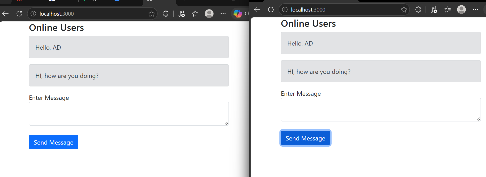

# CHATAPP - Simplilearn TypeScript Project

**Student Name:** AD MALSWMDAWNGI  
**Section:** BSIT2A  
**Subject:** Object Oriented Programming  

---

## 📌 Project Description

This real-time chat application was built for the Simplilearn SkillUp TypeScript course project. It enables instant messaging between multiple browser windows using a Node.js backend and Socket.IO.

### Core Highlights:
- **TypeScript Integration:** Uses explicit types, interfaces, and static type checking to ensure clean code execution.
- **Real-Time Messaging:** Connects multiple clients simultaneously via WebSockets (Socket.IO).
- **Full-Stack Setup:** Features an Express.js server on the backend with an interactive web UI on the frontend.

---

## 📸 App Screenshot



---

## 🛠️ How to Install and Run

### Prerequisites
* [Node.js](https://nodejs.org/) (v16 or higher installed)
* `npm` (comes pre-installed with Node.js)

### Setup Steps

1. **Clone the repository:**
   ```bash
   git clone [https://github.com/dawng2519458-jpg/CHATAPP.git](https://github.com/dawng2519458-jpg/CHATAPP.git)
   cd CHATAPP